<div align="center">


# Visit Drežnica

**Malo mjesto. Veliki doživljaji.**<br/>
<sub><i>Small place. Big experiences.</i></sub>

A tourism platform for Drežnica, a village on the Neretva river near Mostar (Bosnia and Herzegovina):<br/>
accommodation, equipment rental, guided activities and places worth visiting.<br/>
Guests book and pay in the mobile app, while the administrator runs everything from the desktop app.


<br/>


</div>

---

## Contents

- [About](#about)
- [Mobile app](#mobile-app)
- [Desktop app](#desktop-app)
- [Architecture](#architecture)
- [Getting started](#getting-started)
- [Test accounts](#test-accounts)
- [Payments (Stripe test mode)](#payments-stripe-test-mode)
- [Recommendation system](#recommendation-system)
- [Repository structure](#repository-structure)
- [Notes](#notes)

---

## About

| 🧭 Guest (mobile app) | 🛠️ Administrator (desktop app) |
|---|---|
| Browse and search rooms, equipment, activities and places | Dashboard with revenue, reservations and ratings |
| Details with photo gallery, reviews and map | Confirm, reject, cancel and complete reservations |
| Book a stay, rent equipment or join an activity slot | Manage rooms, equipment, activities and slots, places, news |
| Online card payment (Stripe) with refunds on cancellation | Manage users and code lists |
| Favorites, reviews, notifications and news | Review moderation |
| Personalized recommendations (ML) with an explanation | PDF reports (finance, occupancy, activities) |
| Map of places with directions | Recommendation model quality and manual retraining |
| Sign-up, profile editing, password change and reset | Notifications about new paid reservations |

Both apps support **light and dark themes**, are available in **Bosnian and English**, and adapt to the screen size (phone, tablet, narrow and wide windows).
The screenshots below are in Bosnian, the app's primary language.

---

## Mobile app

<table>
  <tr>
    <td align="center" width="25%"><br/><sub><b>Home</b></sub></td>
    <td align="center" width="25%">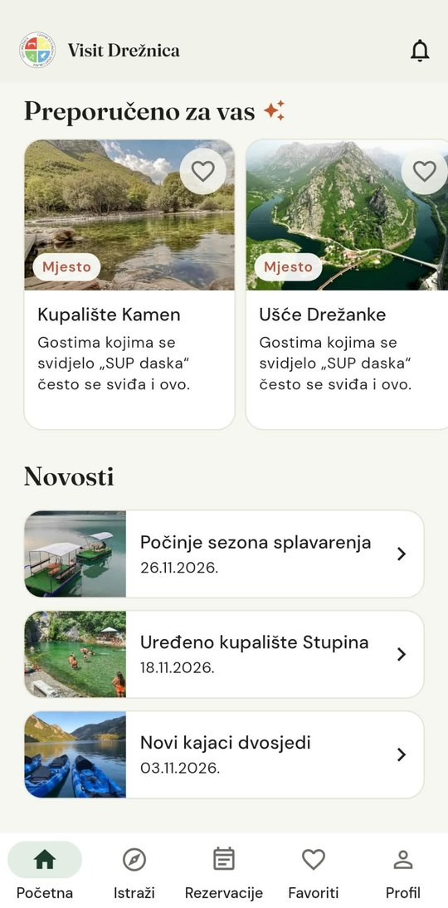<br/><sub><b>Recommendations and news</b></sub></td>
    <td align="center" width="25%"><br/><sub><b>Explore</b></sub></td>
    <td align="center" width="25%">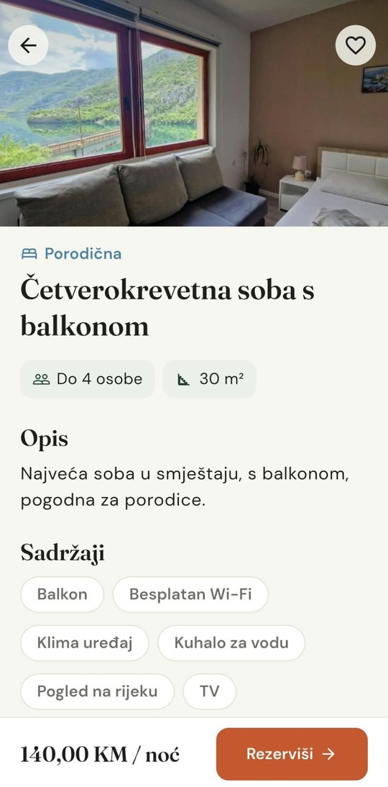<br/><sub><b>Room details</b></sub></td>
  </tr>
  <tr>
    <td align="center">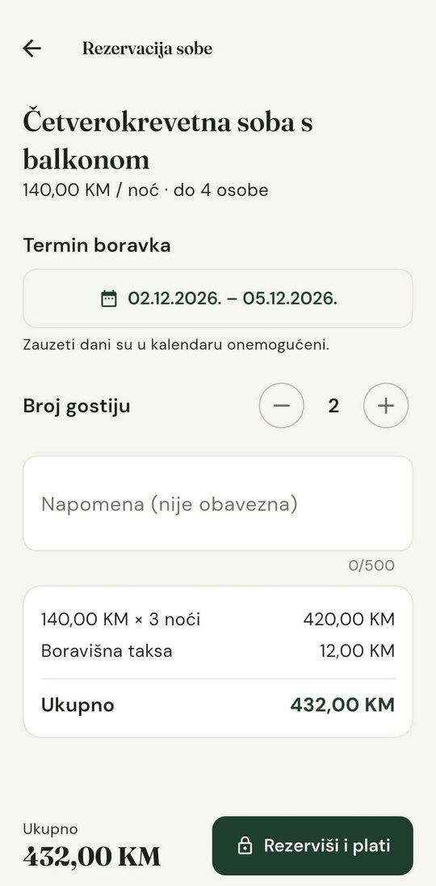<br/><sub><b>Booking and price breakdown</b></sub></td>
    <td align="center">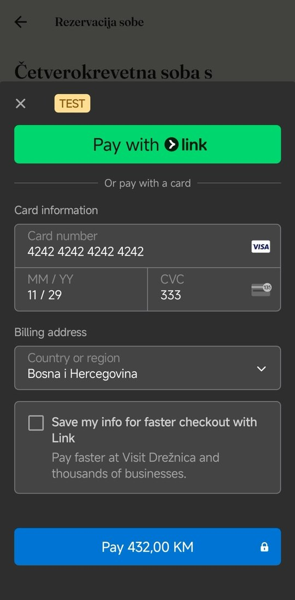<br/><sub><b>Payment (Stripe)</b></sub></td>
    <td align="center">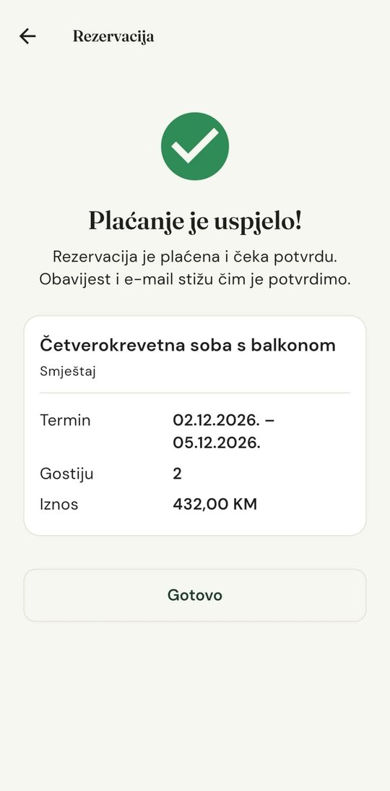<br/><sub><b>Payment confirmation</b></sub></td>
    <td align="center">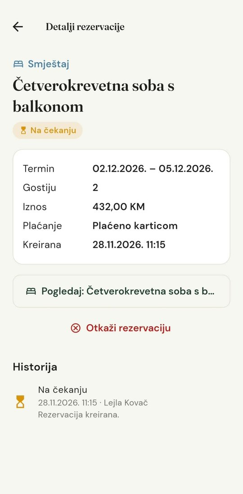<br/><sub><b>Reservation details</b></sub></td>
  </tr>
  <tr>
    <td align="center">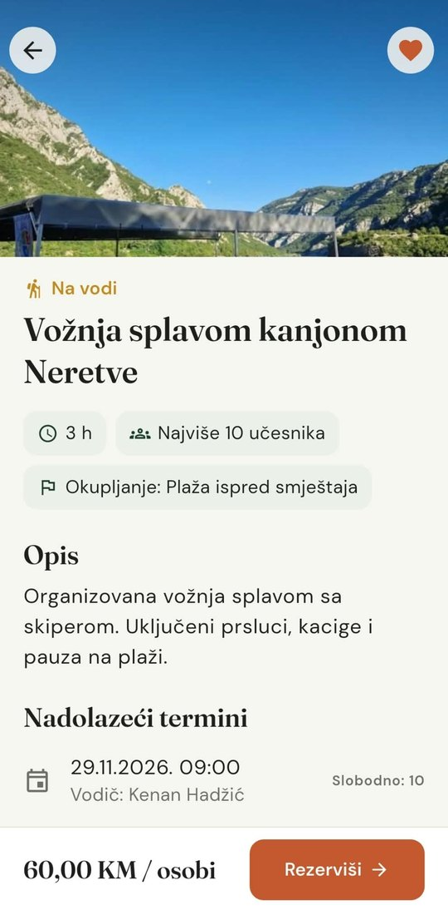<br/><sub><b>Activity and slots</b></sub></td>
    <td align="center">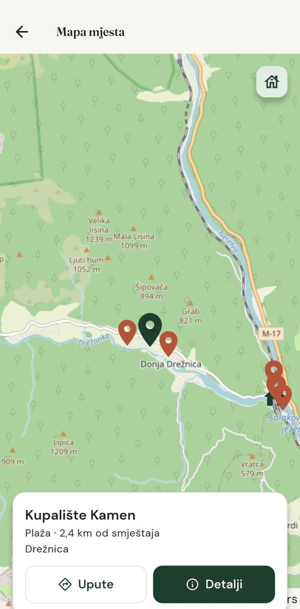<br/><sub><b>Map of places</b></sub></td>
    <td align="center"><br/><sub><b>My bookings</b></sub></td>
    <td align="center">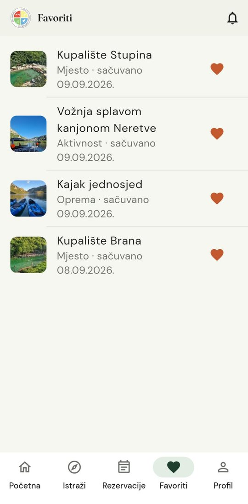<br/><sub><b>Favorites</b></sub></td>
  </tr>
  <tr>
    <td align="center">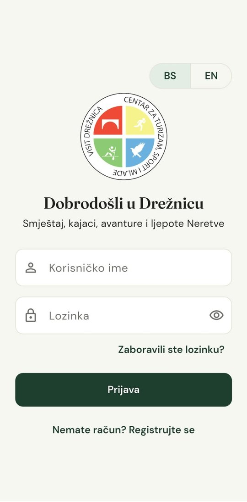<br/><sub><b>Login</b></sub></td>
    <td align="center">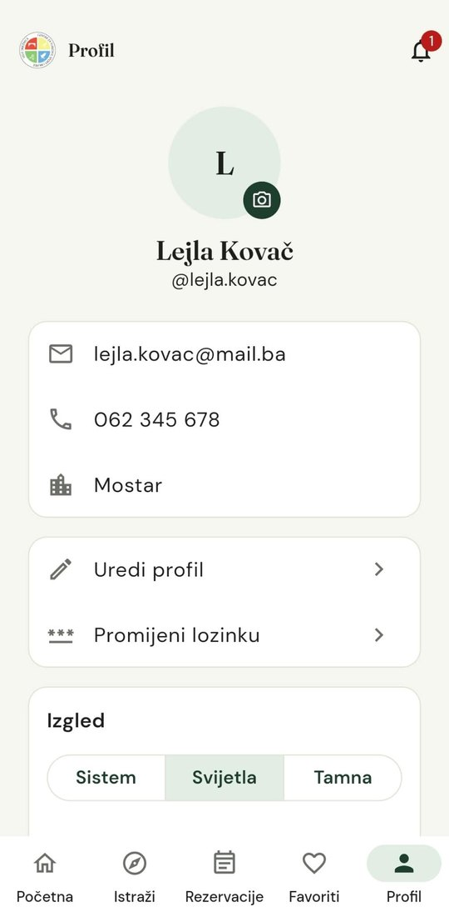<br/><sub><b>Profile, theme and language</b></sub></td>
    <td align="center"><br/><sub><b>Dark theme</b></sub></td>
    <td align="center">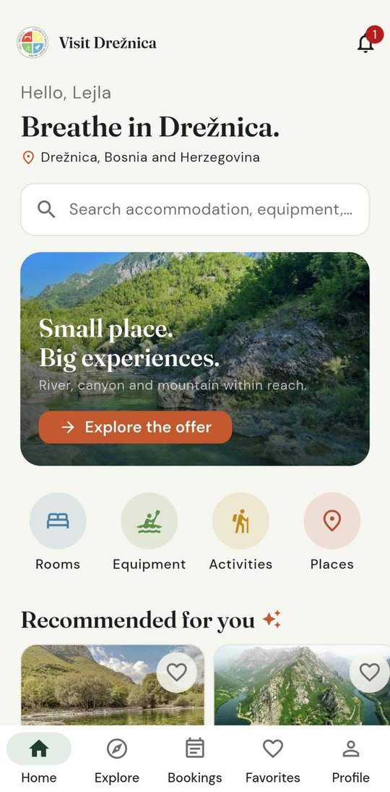<br/><sub><b>English</b></sub></td>
  </tr>
</table>

---

## Desktop app

<table>
  <tr>
    <td align="center" width="50%"><br/><sub><b>Dashboard</b>: monthly revenue, reservations by status, ratings</sub></td>
    <td align="center" width="50%"><br/><sub><b>Reservations</b>: search and filters by type, status and period</sub></td>
  </tr>
  <tr>
    <td align="center"><br/><sub><b>Reservation details</b>: confirm or reject, with status history</sub></td>
    <td align="center"><br/><sub><b>Rooms</b>: list with photos, type, capacity and price</sub></td>
  </tr>
  <tr>
    <td align="center"><br/><sub><b>Room form</b>: amenities and gallery with a cover photo</sub></td>
    <td align="center"><br/><sub><b>Place form</b>: location is picked by clicking on the map</sub></td>
  </tr>
  <tr>
    <td align="center"><br/><sub><b>Activity</b>: slots with guide and occupancy</sub></td>
    <td align="center">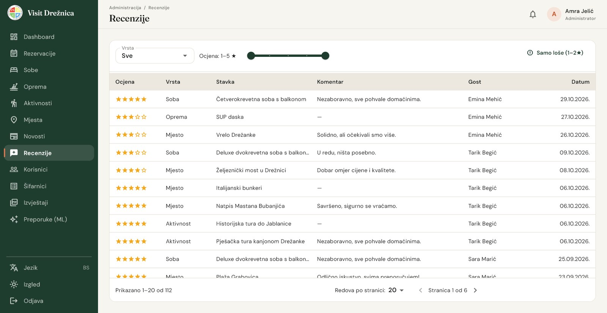<br/><sub><b>Reviews</b>: filter by type and rating range</sub></td>
  </tr>
  <tr>
    <td align="center"><br/><sub><b>Reports</b>: three PDF reports for a chosen period</sub></td>
    <td align="center">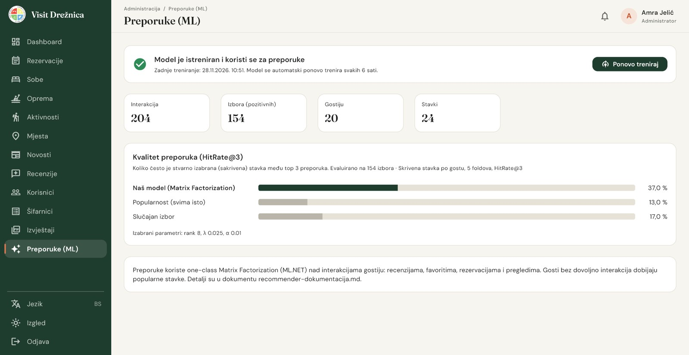<br/><sub><b>Recommendations (ML)</b>: model quality compared to baselines</sub></td>
  </tr>
  <tr>
    <td align="center">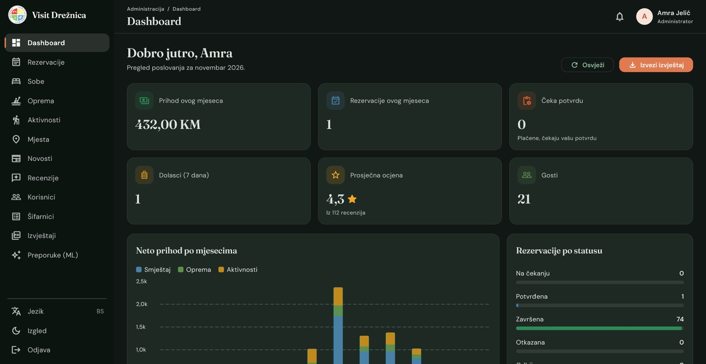<br/><sub><b>Dark theme</b></sub></td>
    <td align="center"><br/><sub><b>Code lists</b>: types, amenities, categories, guides, countries, cities</sub></td>
  </tr>
</table>

<details>
<summary><b>Login and narrow window</b></summary>
<br/>
<table>
  <tr>
    <td align="center" width="50%"><br/><sub><b>Login</b> with language selection</sub></td>
    <td align="center" width="50%"><br/><sub><b>Narrow window</b>: the form switches to a single column</sub></td>
  </tr>
</table>
</details>

---

## Architecture

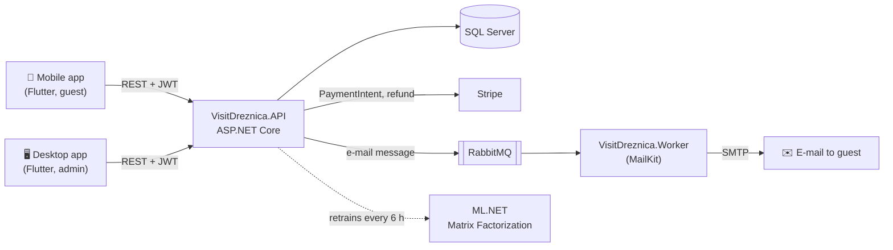

| Project | Role |
|---|---|
| `VisitDreznica.API` | REST API, JWT authentication and roles, background model training and expiry of unpaid reservations |
| `VisitDreznica.Services` | Business logic, EF Core (code first, migrations), reservation state machine, Stripe, recommendations, PDF reports, seed data |
| `VisitDreznica.Model` | Requests, responses, enums, exceptions and message translations (bs/en) |
| `VisitDreznica.Worker` | Consumes RabbitMQ messages and sends e-mails to guests (e.g. reservation status changes, password reset codes) |
| `UI/visitdreznica_core` | Shared Flutter package: API client, models, services, theme, translations |
| `UI/visitdreznica_desktop` | Desktop app for the administrator (Windows) |
| `UI/visitdreznica_mobile` | Mobile app for guests (Android) |

**Tech stack:** .NET 10, ASP.NET Core, Entity Framework Core, SQL Server 2022, RabbitMQ, MailKit, Stripe.net, ML.NET, QuestPDF, Mapster · Flutter, Provider, flutter_stripe, flutter_map (OpenStreetMap), fl_chart · Docker Compose.

---

## Getting started

### Prerequisites

- [Docker Desktop](https://www.docker.com/products/docker-desktop/)
- [Flutter SDK](https://docs.flutter.dev/get-started/install) (3.44 or newer) with Windows desktop and Android support
- An Android emulator or phone (for the mobile app)

### 1. Configuration (`.env`)

All secrets and settings (database, RabbitMQ, JWT, Stripe, SMTP) are read from a `.env` file, which is not in the repository for security reasons.
It is provided separately (as a password-protected `.env-tajne.zip`) and must be extracted into the repository root, so that `.env` sits next to `docker-compose.yml`.

### 2. Backend (Docker)

```powershell
docker compose up -d --build
```

This starts four containers: SQL Server, RabbitMQ, API and Worker. On first start the API automatically:

1. creates the database through migrations,
2. seeds initial data (users, offer with photos, reservations, reviews…),
3. trains the recommendation model.

| Service | URL |
|---|---|
| API | http://localhost:5291 |
| API documentation (Scalar) | http://localhost:5291/scalar |
| RabbitMQ management | http://localhost:15672 |

For a completely fresh install (deletes the database): `docker compose down -v`, then `docker compose up -d --build` again.

### 3. Desktop app

```powershell
cd UI/visitdreznica_core
flutter pub get
flutter gen-l10n

cd ../visitdreznica_desktop
flutter pub get
flutter run -d windows
```

The API address is set at launch (`--dart-define=API_BASE_URL=...`) and defaults to `http://localhost:5291`.

### 4. Mobile app

**Android emulator** (the emulator reaches the host at `10.0.2.2`, which is also the default):

```powershell
cd UI/visitdreznica_mobile
flutter pub get
flutter run --dart-define=API_BASE_URL=http://10.0.2.2:5291
```

**Phone over USB:**

```powershell
adb reverse tcp:5291 tcp:5291
flutter run --dart-define=API_BASE_URL=http://localhost:5291
```

### Prebuilt apps

[Releases](../../releases) contain `fit-build-<date>.zip` with:

- **Android APK** (`app-release.apk`), built for the emulator (`API_BASE_URL=http://10.0.2.2:5291`)
- **Windows app** (`Release` folder), started with `visitdreznica_desktop.exe` (`API_BASE_URL=http://localhost:5291`)

The backend is still started with Docker, as in step 2.

---

## Test accounts

| App | Username | Password | Note |
|---|---|---|---|
| Desktop (administrator) | `desktop` | `test` | |
| Mobile (guest) | `mobile` | `test` | new guest with no history: sees popular items (cold start) |
| Mobile (guest) | `lejla.kovac` | `test` | guest with history: personalized recommendations, bookings, favorites |

All other seeded guests (e.g. `sara.maric`, `tarik.begic`, `emina.mehic`) also use the password `test`.

---

## Payments (Stripe test mode)

Payments run in **Stripe test mode**, so no real money is involved. Use the test card:

| Card number | Expiry | CVC |
|---|---|---|
| `4242 4242 4242 4242` | any future date (e.g. `12/34`) | any 3 digits |

- The server **verifies the payment status with Stripe itself**; the app cannot fake a successful payment.
- When a paid reservation is cancelled, the money is **refunded automatically** to the card.
- An unpaid reservation is cancelled after 30 minutes.

---

## Recommendation system

On the home screen, guests get personalized recommendations from the whole offer, each with an explanation of why it was recommended.

- **Method:** collaborative filtering, *one-class Matrix Factorization* (ML.NET).
- **Signals:** reviews, favorites, reservations and detail views.
- **Quality (HitRate@3):** **0.370**, compared to 0.130 for popularity-based recommendations and 0.170 for random picks.
- **Cold start:** new guests get popular items (Bayesian average).

Full documentation (in Bosnian): [`recommender-dokumentacija.md`](recommender-dokumentacija.md).

---

## Repository structure

```
VisitDreznica/
├── VisitDreznica.API/          # REST API (ASP.NET Core)
├── VisitDreznica.Services/     # business logic, EF Core, seed data (Database/Seed/Images)
├── VisitDreznica.Model/        # DTOs, enums, exceptions, message translations
├── VisitDreznica.Worker/       # e-mail sending (RabbitMQ → SMTP)
├── UI/
│   ├── visitdreznica_core/     # shared Flutter package (API, models, theme, translations)
│   ├── visitdreznica_desktop/  # admin app (Windows)
│   └── visitdreznica_mobile/   # guest app (Android)
├── docs/                       # README images
├── docker-compose.yml
└── recommender-dokumentacija.md
```

---

## Notes

- **Photos:** photos used in the app and seed data were taken from publicly available sources and are used solely for non-commercial, educational purposes. All rights belong to their respective authors.
- **Maps:** © [OpenStreetMap](https://www.openstreetmap.org/copyright) contributors.
- **Fonts:** [DM Sans](https://fonts.google.com/specimen/DM+Sans) and [Fraunces](https://fonts.google.com/specimen/Fraunces), both under the SIL Open Font License 1.1 (licenses are included with the fonts in `UI/visitdreznica_core/assets/fonts`).
- **Language:** the apps, error messages and recommendation explanations follow the selected language (Bosnian/English). Content entered by the administrator (names, descriptions, news), e-mails, notifications and PDF reports are in Bosnian.

---

<div align="center">

Made by **Namik Omerović** · 2026

</div>
