<div align="center">


# Visit Drežnica

**Malo mjesto. Veliki doživljaji.**

Sistem za turističku ponudu Drežnice kod Mostara: smještaj, najam opreme, organizovane aktivnosti i mjesta koja vrijedi posjetiti.<br/>
Gosti rezervišu i plaćaju kroz mobilnu aplikaciju, a administrator sve vodi iz desktop aplikacije.


<br/>

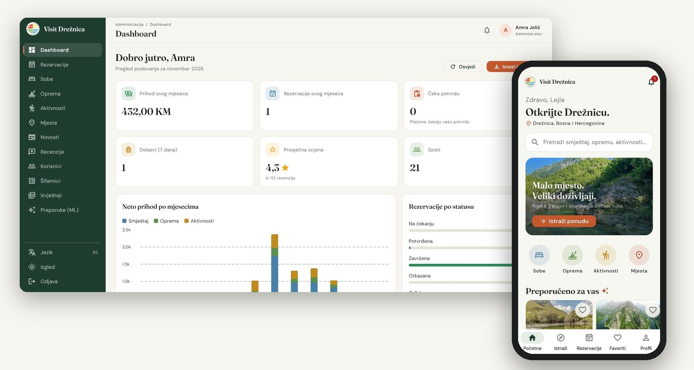

</div>

---

## Sadržaj

- [O projektu](#o-projektu)
- [Mobilna aplikacija](#mobilna-aplikacija)
- [Desktop aplikacija](#desktop-aplikacija)
- [Arhitektura](#arhitektura)
- [Pokretanje](#pokretanje)
- [Pristupni podaci](#pristupni-podaci)
- [Plaćanje (Stripe, test način)](#plaćanje-stripe-test-način)
- [Sistem preporuke](#sistem-preporuke)
- [Struktura repozitorija](#struktura-repozitorija)
- [Napomene](#napomene)

---

## O projektu

| 🧭 Gost (mobilna aplikacija) | 🛠️ Administrator (desktop aplikacija) |
|---|---|
| Pregled i pretraga soba, opreme, aktivnosti i mjesta | Dashboard s prihodom, rezervacijama i ocjenama |
| Detalji sa galerijom slika, recenzijama i mapom | Potvrda, odbijanje, otkazivanje i završavanje rezervacija |
| Rezervacija smještaja, najma opreme i termina aktivnosti | Upravljanje sobama, opremom, aktivnostima i terminima, mjestima, novostima |
| Online plaćanje karticom (Stripe) i povrat novca pri otkazivanju | Upravljanje korisnicima i šifarnicima |
| Favoriti, recenzije, obavijesti i novosti | Moderacija recenzija |
| Personalizovane preporuke (ML) uz objašnjenje | PDF izvještaji (finansije, zauzetost, aktivnosti) |
| Mapa mjesta s uputama do lokacije | Pregled kvaliteta modela preporuka i ručno treniranje |
| Registracija, uređivanje profila, promjena i reset lozinke | Obavijesti o novim plaćenim rezervacijama |

Obje aplikacije imaju **svijetlu i tamnu temu**, rade na **bosanskom i engleskom jeziku** i prilagođavaju se veličini ekrana (telefon, tablet, uži i širi prozor).

---

## Mobilna aplikacija

<table>
  <tr>
    <td align="center" width="25%">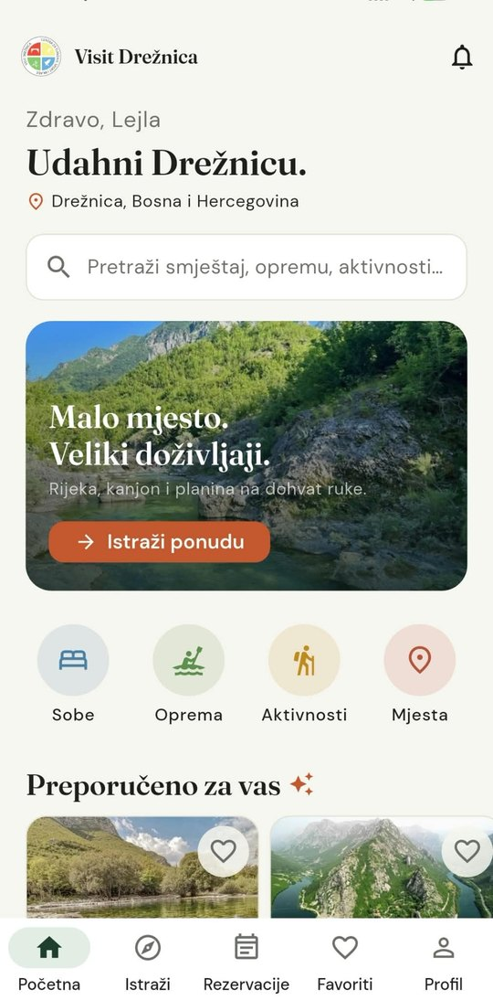<br/><sub><b>Početna</b></sub></td>
    <td align="center" width="25%"><br/><sub><b>Preporuke i novosti</b></sub></td>
    <td align="center" width="25%">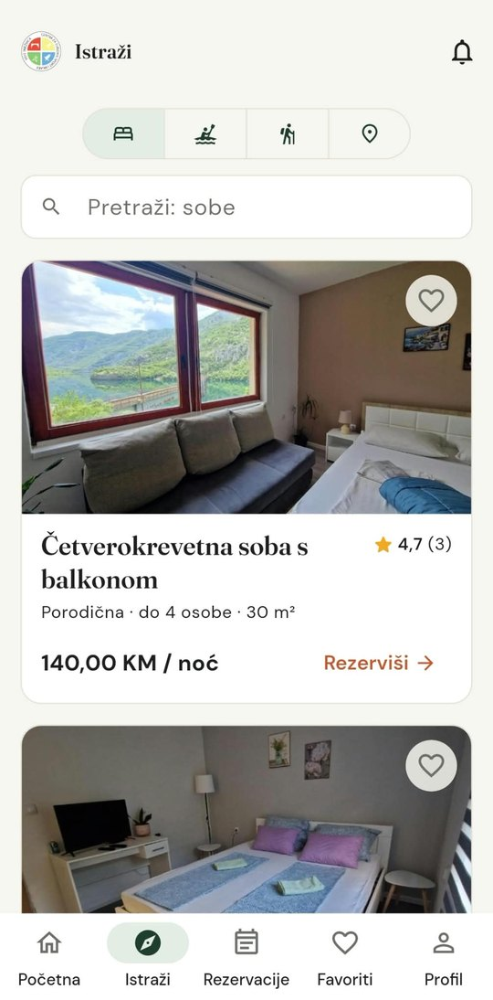<br/><sub><b>Istraži</b></sub></td>
    <td align="center" width="25%"><br/><sub><b>Detalji sobe</b></sub></td>
  </tr>
  <tr>
    <td align="center"><br/><sub><b>Rezervacija i obračun</b></sub></td>
    <td align="center"><br/><sub><b>Plaćanje (Stripe)</b></sub></td>
    <td align="center"><br/><sub><b>Potvrda plaćanja</b></sub></td>
    <td align="center"><br/><sub><b>Detalji rezervacije</b></sub></td>
  </tr>
  <tr>
    <td align="center"><br/><sub><b>Aktivnost i termini</b></sub></td>
    <td align="center"><br/><sub><b>Mapa mjesta</b></sub></td>
    <td align="center">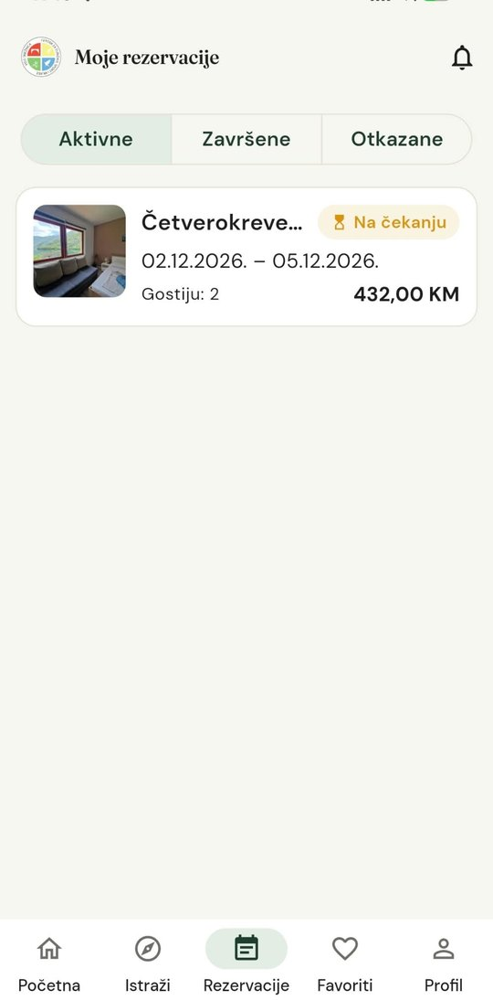<br/><sub><b>Moje rezervacije</b></sub></td>
    <td align="center"><br/><sub><b>Favoriti</b></sub></td>
  </tr>
  <tr>
    <td align="center"><br/><sub><b>Prijava</b></sub></td>
    <td align="center"><br/><sub><b>Profil, tema i jezik</b></sub></td>
    <td align="center">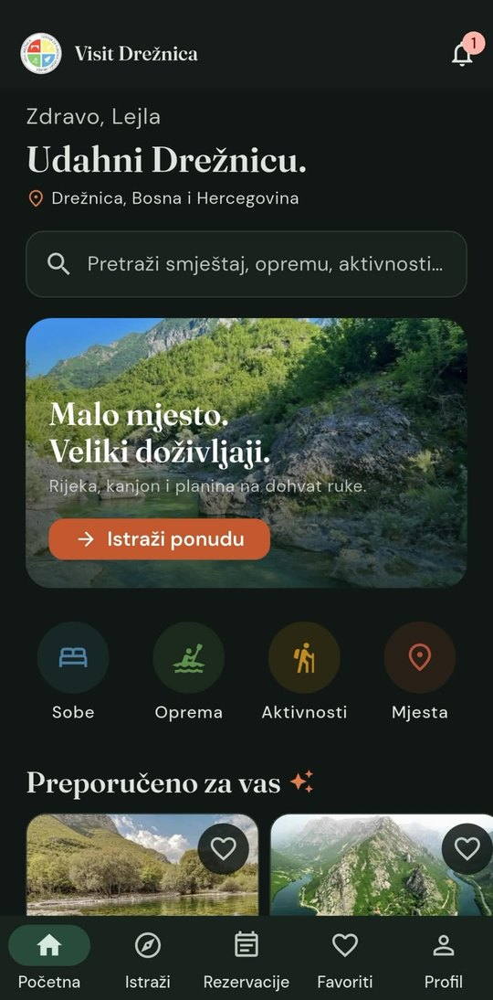<br/><sub><b>Tamna tema</b></sub></td>
    <td align="center"><br/><sub><b>English</b></sub></td>
  </tr>
</table>

---

## Desktop aplikacija

<table>
  <tr>
    <td align="center" width="50%">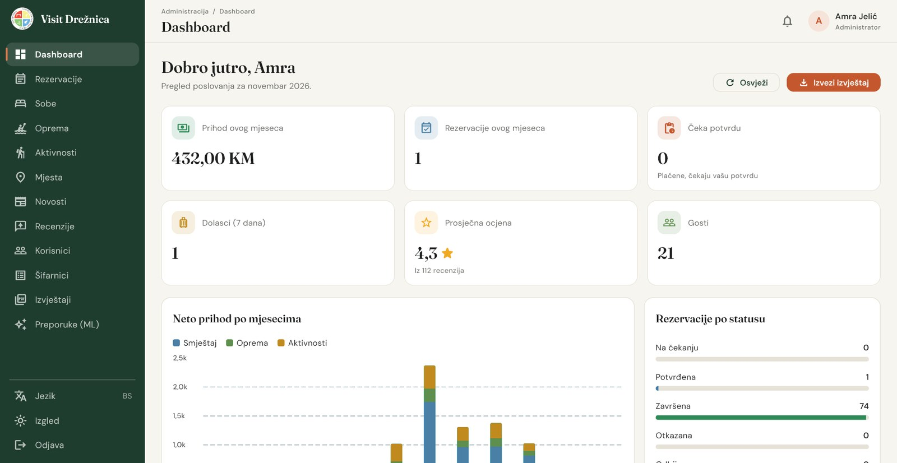<br/><sub><b>Dashboard</b>: prihod po mjesecima, rezervacije po statusu, ocjene</sub></td>
    <td align="center" width="50%">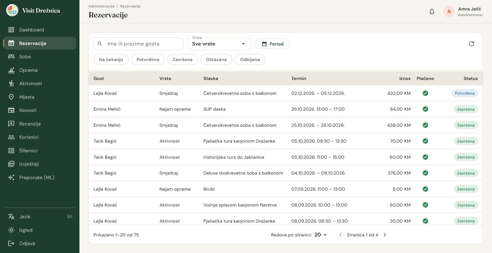<br/><sub><b>Rezervacije</b>: pretraga i filteri po vrsti, statusu i periodu</sub></td>
  </tr>
  <tr>
    <td align="center">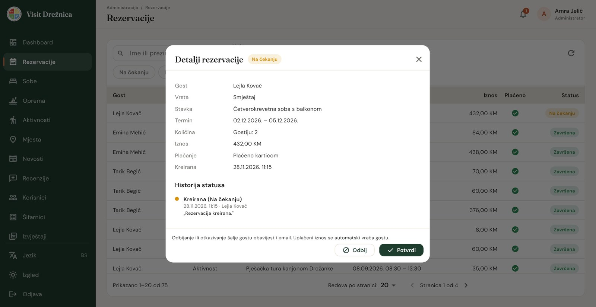<br/><sub><b>Detalji rezervacije</b>: potvrda ili odbijanje uz historiju statusa</sub></td>
    <td align="center">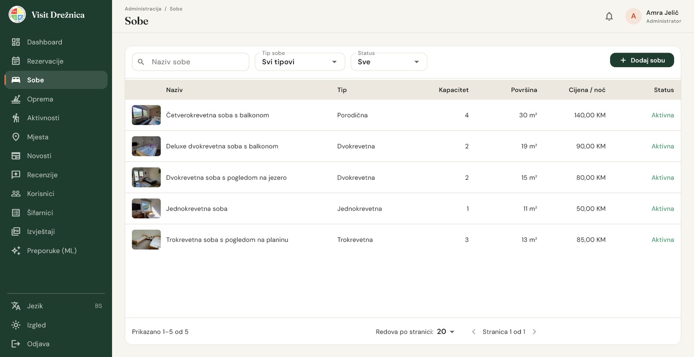<br/><sub><b>Sobe</b>: lista sa slikama, tipom, kapacitetom i cijenom</sub></td>
  </tr>
  <tr>
    <td align="center">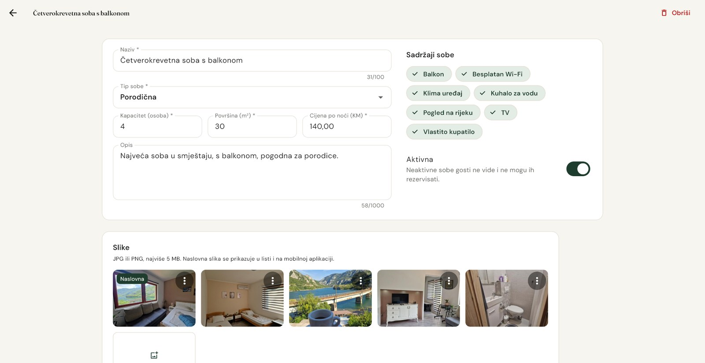<br/><sub><b>Forma sobe</b>: sadržaji i galerija s naslovnom slikom</sub></td>
    <td align="center">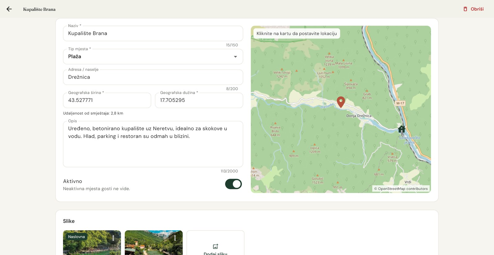<br/><sub><b>Forma mjesta</b>: lokacija se bira klikom na mapu</sub></td>
  </tr>
  <tr>
    <td align="center">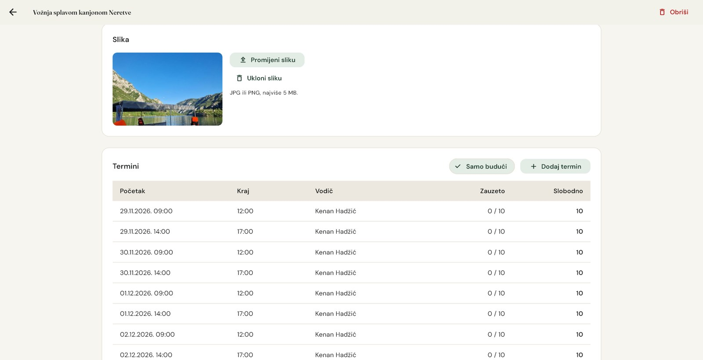<br/><sub><b>Aktivnost</b>: termini s vodičem i popunjenošću</sub></td>
    <td align="center"><br/><sub><b>Recenzije</b>: filter po vrsti i rasponu ocjene</sub></td>
  </tr>
  <tr>
    <td align="center">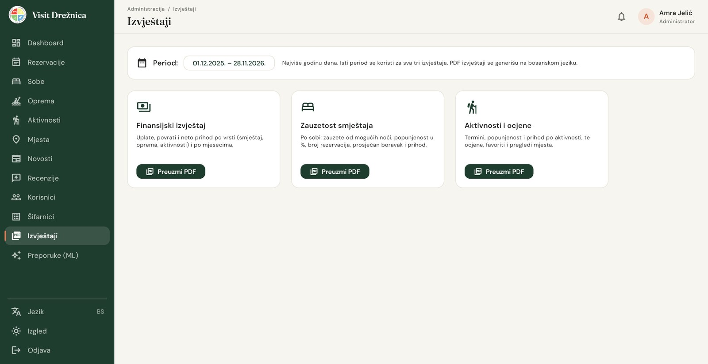<br/><sub><b>Izvještaji</b>: tri PDF izvještaja za odabrani period</sub></td>
    <td align="center"><br/><sub><b>Preporuke (ML)</b>: kvalitet modela u odnosu na osnovne pristupe</sub></td>
  </tr>
  <tr>
    <td align="center"><br/><sub><b>Tamna tema</b></sub></td>
    <td align="center">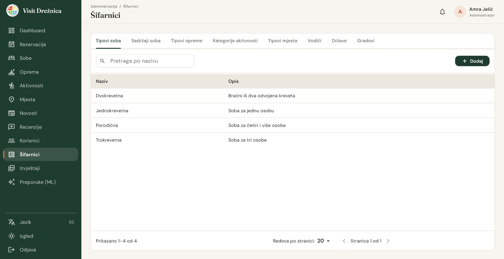<br/><sub><b>Šifarnici</b>: tipovi, sadržaji, kategorije, vodiči, države, gradovi</sub></td>
  </tr>
</table>

<details>
<summary><b>Prijava i prikaz u uskom prozoru</b></summary>
<br/>
<table>
  <tr>
    <td align="center" width="50%">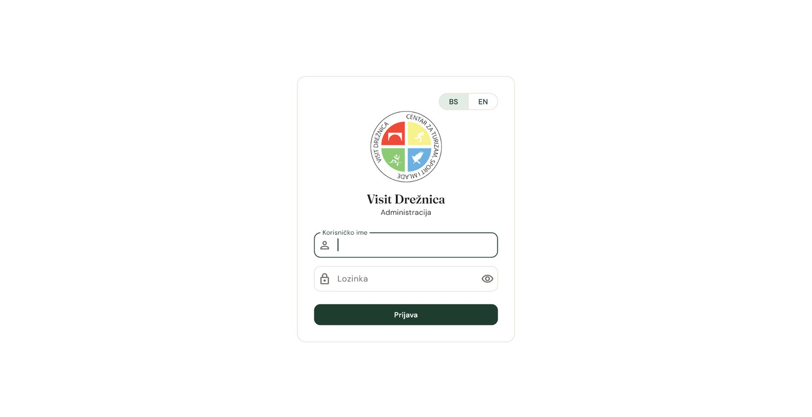<br/><sub><b>Prijava</b> s izborom jezika</sub></td>
    <td align="center" width="50%">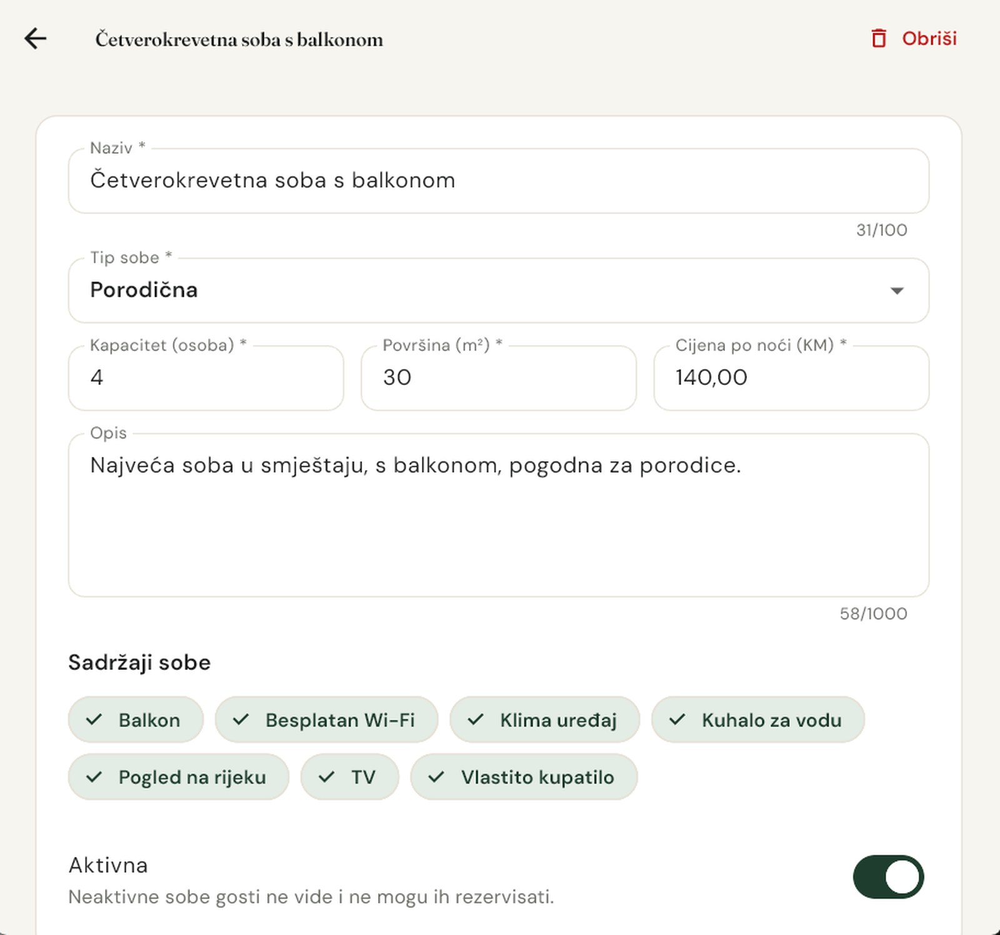<br/><sub><b>Uski prozor</b>: forma prelazi u jednu kolonu</sub></td>
  </tr>
</table>
</details>

---

## Arhitektura

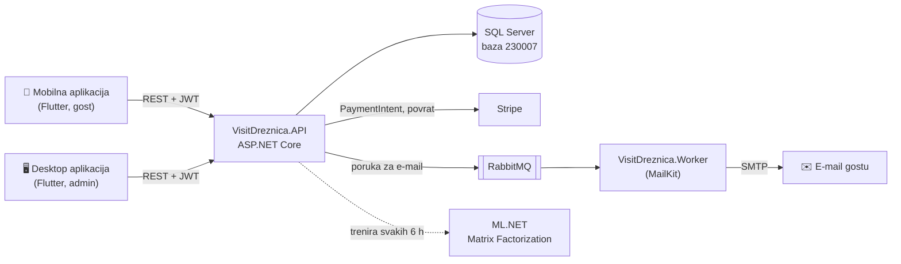

| Projekat | Uloga |
|---|---|
| `VisitDreznica.API` | REST API, JWT autentifikacija i uloge, pozadinsko treniranje modela i istek neplaćenih rezervacija |
| `VisitDreznica.Services` | Poslovna logika, EF Core (Code First, migracije), stanja rezervacije, Stripe, preporuke, PDF izvještaji, seed |
| `VisitDreznica.Model` | Zahtjevi, odgovori, enumi, izuzeci i prijevodi poruka (bs/en) |
| `VisitDreznica.Worker` | Prima poruke iz RabbitMQ-a i šalje e-mailove gostima (npr. promjena statusa rezervacije, kod za reset lozinke) |
| `UI/visitdreznica_core` | Zajednički Flutter paket: API klijent, modeli, servisi, tema, prijevodi |
| `UI/visitdreznica_desktop` | Desktop aplikacija za administratora (Windows) |
| `UI/visitdreznica_mobile` | Mobilna aplikacija za goste (Android) |

**Tehnologije:** .NET 10, ASP.NET Core, Entity Framework Core, SQL Server 2022, RabbitMQ, MailKit, Stripe.net, ML.NET, QuestPDF, Mapster · Flutter, Provider, flutter_stripe, flutter_map (OpenStreetMap), fl_chart · Docker Compose.

---

## Pokretanje

### Preduslovi

- [Docker Desktop](https://www.docker.com/products/docker-desktop/)
- [Flutter SDK](https://docs.flutter.dev/get-started/install) (3.44 ili noviji) s podrškom za Windows desktop i Android
- Android emulator ili telefon (za mobilnu aplikaciju)

### 1. Konfiguracija (`.env`)

Sve tajne i postavke (baza, RabbitMQ, JWT, Stripe, SMTP) čitaju se iz fajla `.env`, koji se iz sigurnosnih razloga ne nalazi u repozitoriju.
Fajl se dobija odvojeno (kao `.env-tajne.zip` zaštićen šifrom) i raspakuje u korijen repozitorija, tako da `.env` stoji pored `docker-compose.yml`.

### 2. Backend (Docker)

```powershell
docker compose up -d --build
```

Pokreću se četiri kontejnera: SQL Server, RabbitMQ, API i Worker. Pri prvom pokretanju API sam:

1. napravi bazu kroz migracije,
2. ubaci početne podatke (korisnike, ponudu sa slikama, rezervacije, recenzije…),
3. istrenira model preporuka.

| Servis | Adresa |
|---|---|
| API | http://localhost:5291 |
| Dokumentacija API-ja (Scalar) | http://localhost:5291/scalar |
| RabbitMQ panel | http://localhost:15672 |

Za potpuno novu instalaciju (briše bazu): `docker compose down -v`, pa ponovo `docker compose up -d --build`.

### 3. Desktop aplikacija

```powershell
cd UI/visitdreznica_core
flutter pub get
flutter gen-l10n

cd ../visitdreznica_desktop
flutter pub get
flutter run -d windows
```

Adresa API-ja se zadaje pri pokretanju (`--dart-define=API_BASE_URL=...`), a podrazumijevana je `http://localhost:5291`.

### 4. Mobilna aplikacija

**Android emulator** (emulator API vidi na adresi `10.0.2.2`, što je i podrazumijevana vrijednost):

```powershell
cd UI/visitdreznica_mobile
flutter pub get
flutter run --dart-define=API_BASE_URL=http://10.0.2.2:5291
```

**Telefon preko USB kabla:**

```powershell
adb reverse tcp:5291 tcp:5291
flutter run --dart-define=API_BASE_URL=http://localhost:5291
```

### Gotovi buildovi

U [Releases](../../releases) se nalazi `fit-build-<datum>.zip` sa:

- **Android APK** (`app-release.apk`), napravljen za emulator (`API_BASE_URL=http://10.0.2.2:5291`)
- **Windows aplikacija** (`Release` folder), pokreće se sa `visitdreznica_desktop.exe` (`API_BASE_URL=http://localhost:5291`)

Backend se i tada pokreće kroz Docker, kao u koraku 2.

---

## Pristupni podaci

| Aplikacija | Korisničko ime | Lozinka | Napomena |
|---|---|---|---|
| Desktop (administrator) | `desktop` | `test` | |
| Mobilna (gost) | `mobile` | `test` | nov gost bez historije: prikazuje popularne stavke (hladan start) |
| Mobilna (gost) | `lejla.kovac` | `test` | gost s historijom: personalizovane preporuke, rezervacije, favoriti |

Svi ostali gosti iz početnih podataka (npr. `sara.maric`, `tarik.begic`, `emina.mehic`) također imaju lozinku `test`.

---

## Plaćanje (Stripe, test način)

Plaćanje radi u **Stripe test načinu**, bez stvarnog novca. Za probu se koristi testna kartica:

| Broj kartice | Datum isteka | CVC |
|---|---|---|
| `4242 4242 4242 4242` | bilo koji budući datum (npr. `12/34`) | bilo koja 3 broja |

- Server **sam provjerava** status uplate kod Stripea; aplikacija ne može „lažno" potvrditi plaćanje.
- Pri otkazivanju plaćene rezervacije novac se **automatski vraća** na karticu.
- Neplaćena rezervacija se otkazuje nakon 30 minuta.

---

## Sistem preporuke

Gost na početnom ekranu dobija personalizovane preporuke iz cijele ponude, uz objašnjenje zašto je nešto preporučeno.

- **Metoda:** kolaborativno filtriranje, *one-class Matrix Factorization* (ML.NET).
- **Signali:** recenzije, favoriti, rezervacije i pregledi detalja.
- **Kvalitet (HitRate@3):** **0.370**, naspram 0.130 za preporuku po popularnosti i 0.170 za slučajan izbor.
- **Hladan start:** novi gosti dobijaju popularne stavke (Bayesov prosjek).

Detaljno: [`recommender-dokumentacija.md`](recommender-dokumentacija.md).

---

## Struktura repozitorija

```
VisitDreznica/
├── VisitDreznica.API/          # REST API (ASP.NET Core)
├── VisitDreznica.Services/     # poslovna logika, EF Core, seed (Database/Seed/Images)
├── VisitDreznica.Model/        # DTO-i, enumi, izuzeci, prijevodi poruka
├── VisitDreznica.Worker/       # slanje e-mailova (RabbitMQ → SMTP)
├── UI/
│   ├── visitdreznica_core/     # zajednički Flutter paket (API, modeli, tema, prijevodi)
│   ├── visitdreznica_desktop/  # admin aplikacija (Windows)
│   └── visitdreznica_mobile/   # aplikacija za goste (Android)
├── docs/                       # slike za README
├── docker-compose.yml
└── recommender-dokumentacija.md
```

---

## Napomene

- **Fotografije:** fotografije u aplikaciji i početnim podacima preuzete su s javno dostupnih izvora i koriste se isključivo u nekomercijalne, edukativne svrhe. Sva prava pripadaju njihovim autorima.
- **Mape:** © [OpenStreetMap](https://www.openstreetmap.org/copyright) contributors.
- **Fontovi:** [DM Sans](https://fonts.google.com/specimen/DM+Sans) i [Fraunces](https://fonts.google.com/specimen/Fraunces), oba pod licencom SIL Open Font License 1.1 (licence se nalaze uz fontove u `UI/visitdreznica_core/assets/fonts`).
- **Jezik:** aplikacije, poruke grešaka i objašnjenja preporuka prate izabrani jezik (bosanski/engleski). Sadržaj koji unosi administrator (nazivi, opisi, novosti), e-mailovi, obavijesti i PDF izvještaji su na bosanskom.

---

<div align="center">

Napravio **Namik Omerović** · 2026.

</div>
